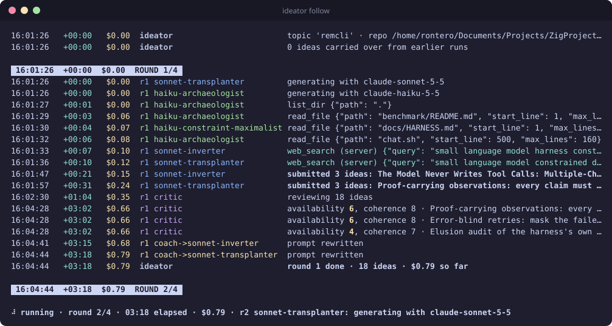
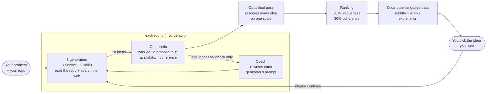
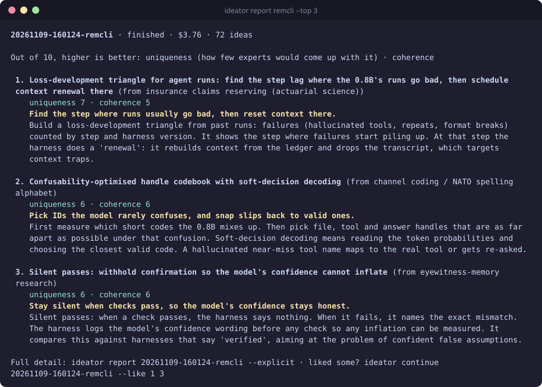
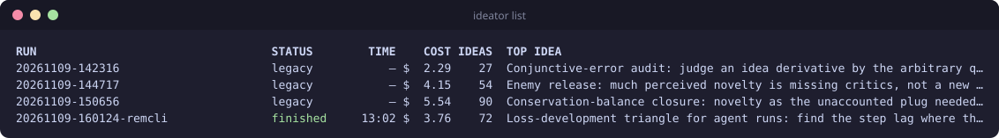

# Ideator

**Describe a problem in plain words, and get back the ideas that the experts in your field would *not* come up with, ranked, explained simply, and ready to steer.**

Ideator runs a loop of Claude models in the spirit of [*The Alien Space of Science*](https://arxiv.org/abs/2603.01092): generators propose ideas while researching your repo and the web, a skeptical critic works out *who* would already have proposed each one, and a coach rewrites each generator's prompt to push it away from well-trodden ground. Only the ideas that are both unusual and coherent rise to the top.

<p align="center"></p>

## How it works



- **Generators** start from different thinking styles: borrowing mechanisms from distant fields, inverting hidden assumptions, reviving abandoned approaches, imposing extreme constraints, thinking like outsiders (editors, examiners, funders), and digging through your code for unused signals.
- **The critic** searches for the closest existing work and names the researchers or labs who would plausibly propose each idea. It scores **availability** (how reachable the idea is for today's experts) and **coherence** (does it hold together).
- **The coach** turns those findings into a critique ("this is basically what X does") and a rewritten prompt. Generators are pushed on **uniqueness only**: they never see coherence, so they are never nudged back toward the safe and obvious.
- **The final pass** rescores every idea from every round together, shuffled and anonymized, so rounds are judged on the same scale.
- **The plain-language pass** keeps each idea's title but rewrites the explanation in simple words, plus a one-line subtitle.

## Quick start

Requirements: [uv](https://docs.astral.sh/uv/), [ripgrep](https://github.com/BurntSushi/ripgrep) (`rg`), and an Anthropic API key.

```bash
git clone --recurse-submodules <this repo> Ideator && cd Ideator
uv sync
echo 'ANTHROPIC_API_KEY=sk-ant-...' > .env        # git-ignored

# optional: an `ideator` command available everywhere
cat > ~/.local/bin/ideator <<EOF
#!/usr/bin/env bash
exec uv run --quiet --project "$PWD" ideator "\$@"
EOF
chmod +x ~/.local/bin/ideator
```

Then explain your problem the way you would to a colleague, and point it at your project:

```bash
ideator new -r ~/code/my-project "We run a 0.8B model behind a harness. It hallucinates tools unless \
they are explained very clearly, assumes things confidently, and falls for distractors when searching. \
What harness designs would let it solve tasks that normally need a bigger model?"
```

Your description is passed to the models **word for word**. You can also use `-f problem.md`, pipe it in, or run `ideator new` and type it.

## Reading the results

`ideator report` shows the top ideas in plain words. Each one keeps its original title, gets a one-line subtitle, names the field it borrows from, and explains what it would actually do for your problem:

<p align="center"></p>

Both scores are out of 10 and **higher is better**:

| Score | Meaning |
|---|---|
| **uniqueness** | How few experts would come up with it (10 − the critic's availability) |
| **coherence** | How well it holds together: technically sound, connected to your problem, buildable |

The ranking is `0.3 × z(coherence) + 0.7 × z(uniqueness)`, standardized across all ideas in the run, as in the Alien paper's fusion score. Use `ideator report --explicit` for the full write-up of each idea, including who the critic thinks would propose it and the closest existing work, or `--page` to read it in `less`.

## Steering toward what you like

When a run you are following finishes, Ideator shows the top ideas and asks which ones you liked:

```text
Which ideas did you like? Numbers like '1 3', Enter to stop: 1 3
What did you like about them? (optional, helps steer; Enter to skip): they attack the model's own failure patterns
Rounds for the next run [4]:
Continuing remcli from 20261109-160124-remcli, steered by 2 liked idea(s).
```

The next run keeps the same problem, repo and topic, and:

- shows your liked ideas (and your note) to the generators and the coach as **a reference for the kind of moves you value**, not something to copy;
- resumes each generator's evolved prompt instead of starting over;
- treats every earlier idea on the topic as already taken, so nothing repeats;
- accumulates likes across continuations.

The same from the command line: `ideator continue remcli --like 1 3 --note "why you liked them"`.

## Commands

| Command | What it does |
|---|---|
| `ideator new [DESCRIPTION] -r PATH [-t TOPIC] [-n ROUNDS]` | Start a run (detached) and follow it live |
| `ideator follow [RUN] [--tail]` | Live colored log: clock time, elapsed time, running cost, and a status line. Ctrl-C only detaches |
| `ideator report [RUN] [--top N] [--explicit] [--page]` | Top ideas in plain words, or the full write-up |
| `ideator continue [RUN] [--like 1 3] [--note WHY] [-n ROUNDS]` | New run steered toward the ideas you liked |
| `ideator list` | Every run with status, time, cost and top idea |
| `ideator simplify [RUN]` | Add the plain-language view to an older run |
| `ideator stop [RUN]` | Stop gracefully: running generators finish, then it ranks and reports what it has |

`RUN` is a run folder name, any unique part of one (e.g. `remcli`), or omitted for the latest run.

<p align="center"></p>

### Tuning a run

Everything after a bare `--` goes to the run itself:

```bash
ideator new -r . "..." -- --beta 0.5 --critic-searches 3 --coach-model claude-opus-5-5
```

| Option | Default | |
|---|---|---|
| `--ideas` | 3 | Ideas per generator per round |
| `--beta` | 0.7 | Weight on uniqueness in the ranking (the rest goes to coherence) |
| `--gen-searches` / `--critic-searches` / `--final-searches` | 4 / 6 / 5 | Web-search budgets |
| `--gen-effort` / `--critic-effort` / `--final-effort` | medium / medium / high | Thinking effort per role |
| `--coach-model` | `claude-sonnet-5-5` | Model that rewrites generator prompts |
| `--simplify-top` | 10 | How many top ideas get the plain-language pass |
| `--max-turns` | 12 | Tool-use turns before an agent is told to submit |
| `--no-carry` | | Ignore ideas from earlier runs on the same topic |
| `--no-fallbacks` | | Disable server-side refusal fallbacks |

## Cost and time

A default run (4 rounds, 6 generators, 72 ideas) on a real repo took **13 minutes and cost $3.46**. The cost table at the end of every `report.md` breaks spending down by role:

| Role | Model | Share of that run |
|---|---|---|
| Critic (per round) | Opus | $1.19 |
| Generators | Sonnet | $1.17 |
| Coach | Sonnet | $0.44 |
| Final pass | Opus | $0.37 |
| Generators | Haiku | $0.29 |

## What a run leaves behind

Each run gets a folder in `runs/` (git-ignored):

| File | Contents |
|---|---|
| `problem.md` | Your description, exactly as the models saw it |
| `summary.md` | The plain-language top ideas |
| `report.md` | Everything: score trends per round, every idea with prior work and who would propose it, how each generator's prompt evolved, and the cost table |
| `state.json` | Machine-readable results (used by `report`, `continue`, `list`) |
| `events.jsonl` | The live log that `ideator follow` renders |
| `liked.json` | For continuations: the ideas and note steering the run |

## Safety

- Generators can only **read** inside the folder you pass with `-r`; symlinks cannot lead outside it.
- Files that look like secrets (`.env`, keys, certificates, credential files) are never read or searched.
- Whatever the generators read is sent to the Anthropic API and written to the run's logs, so point `-r` at the code you are comfortable sharing.

## Project layout

```text
alien_loop/
  cli.py          the ideator command
  run.py          the generator → critic → coach loop, final pass, ranking, reports
  prompts.py      every prompt and tool schema
  llm.py          Claude agent loop (streaming, tool use, refusal fallbacks) and cost tracking
  repo_tools.py   read-only list_dir / read_file / ripgrep tools
  ui.py           event log and the live colored renderer
alien-space-of-science/   the paper's reference implementation (submodule)
```

## Credits

Built on the idea of *coherent but cognitively unavailable* research directions from [The Alien Space of Science: Sampling Coherent but Cognitively Unavailable Research Directions](https://arxiv.org/abs/2603.01092) ([code](https://github.com/alejandrohdez00/alien-space-of-science)). Ideator replaces the paper's trained coherence and availability models with Claude models that research, judge and coach in a loop.
